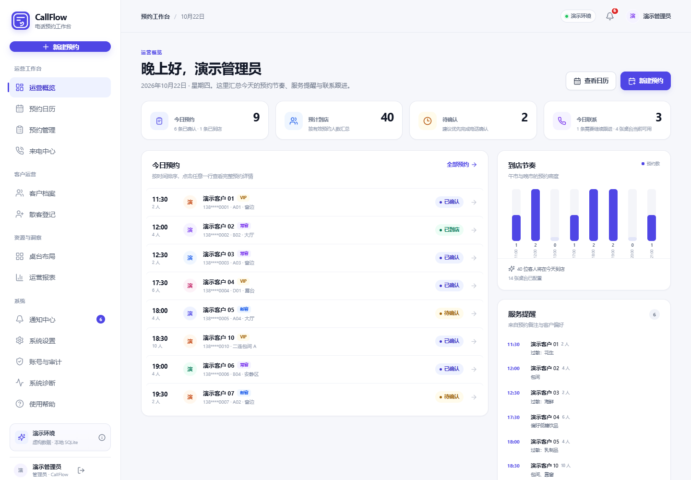
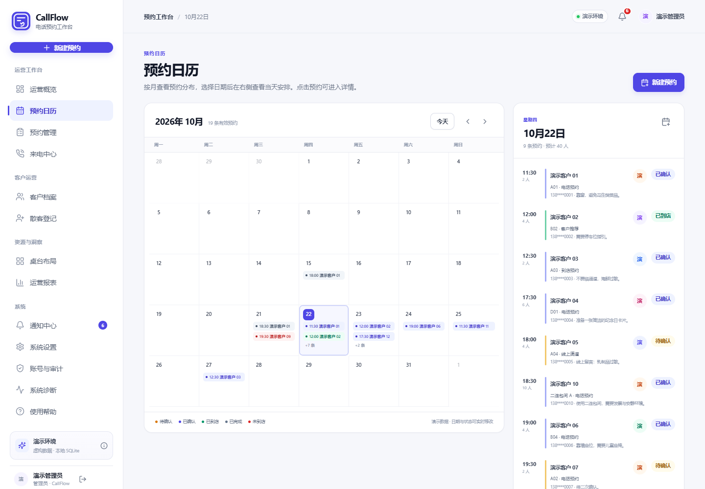
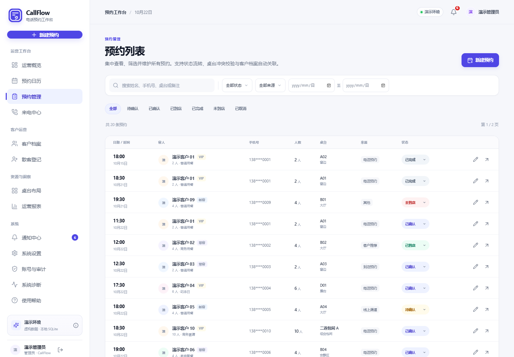
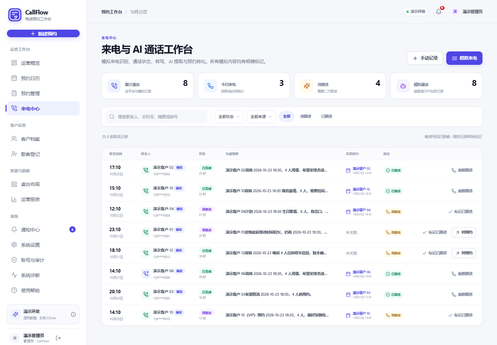
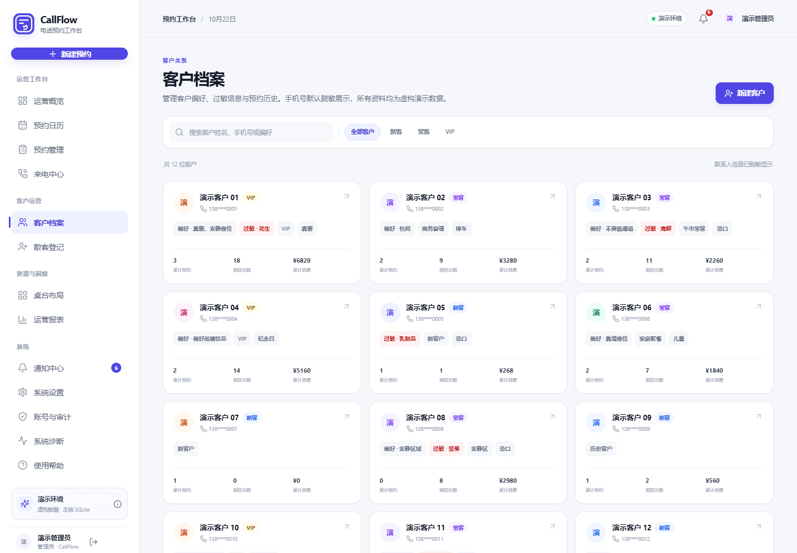
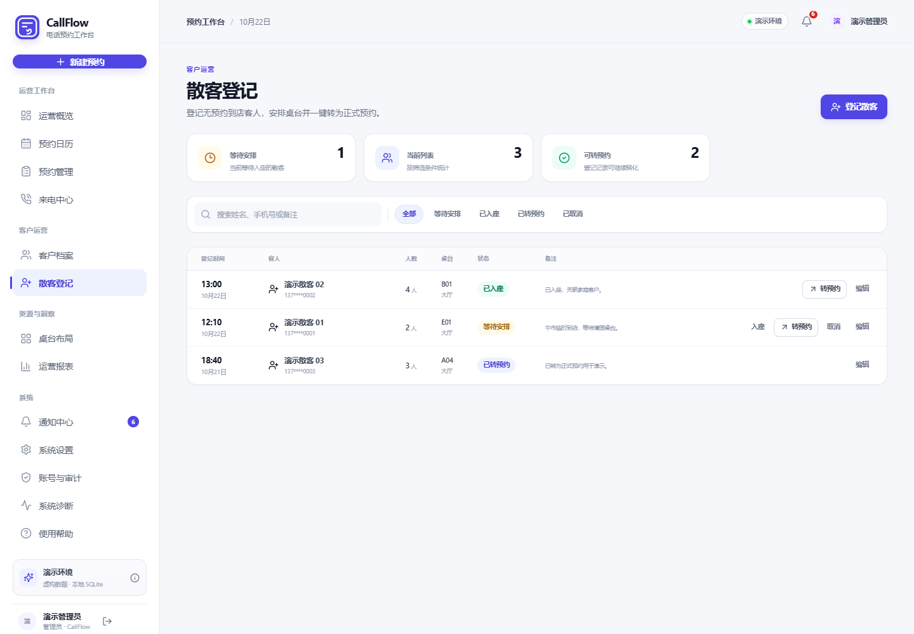
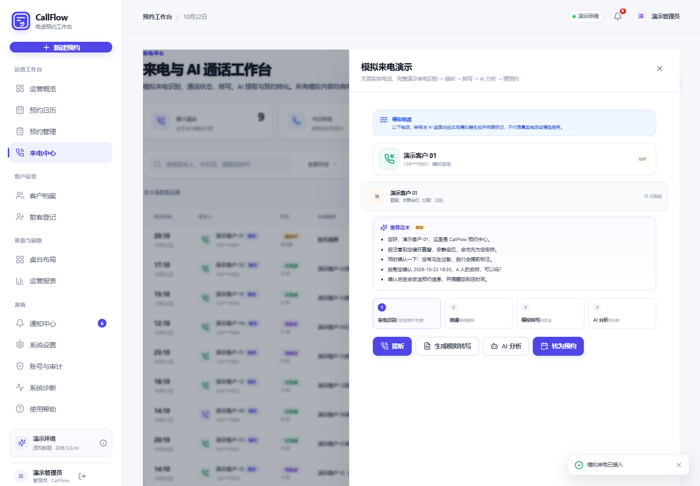
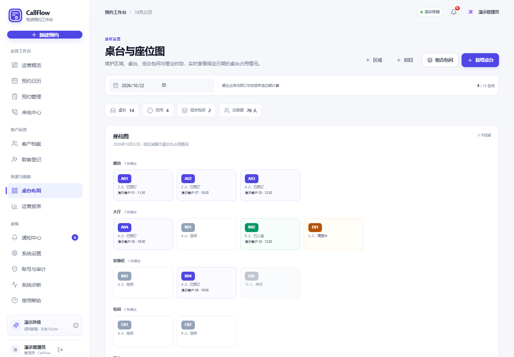
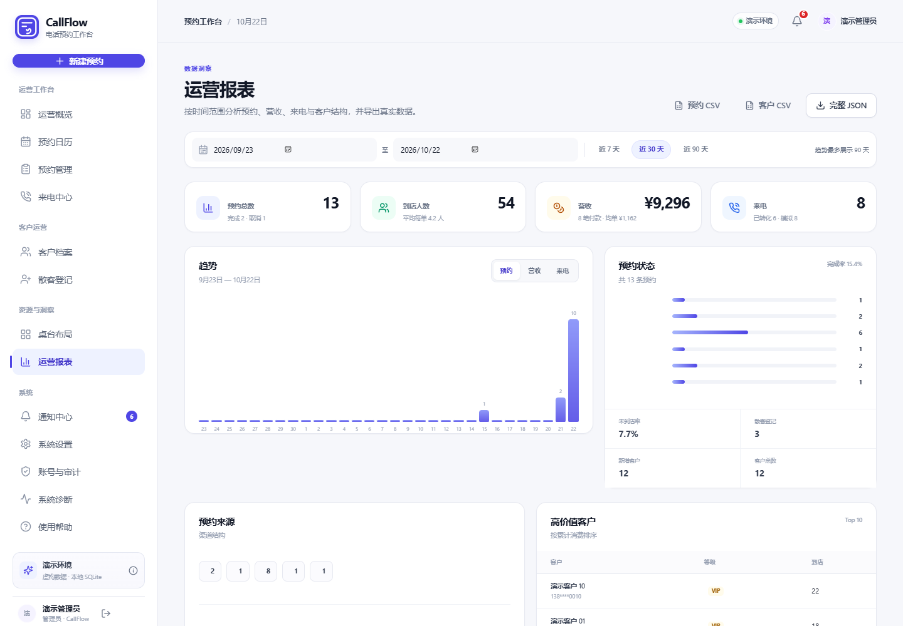
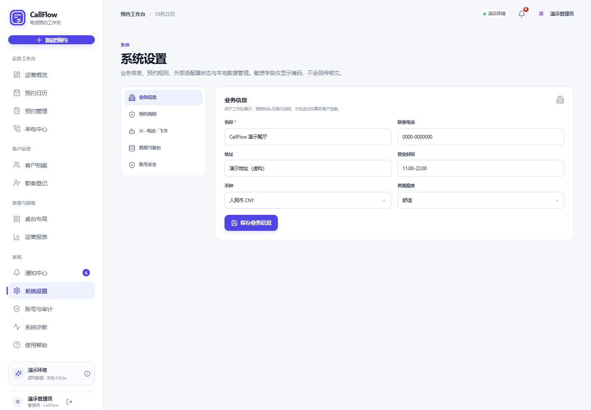

# CallFlow AI Phone Assistant

English | [简体中文](README.md)

> A local-first appointment operations workbench built with React, TypeScript, Express and SQLite.
> Telephony, STT, AI and Feishu are **explicit mock adapters**. Real external services are not connected, and the UI and API say so.



## What this is

CallFlow is a runnable, testable appointment management workbench for restaurants, stores and other booking-based services. It connects the full flow of “incoming call → customer lookup → answer → simulated transcript → simulated AI extraction → appointment creation → customer profile update”, together with appointments, tables, customers, walk-ins, reports, notifications and administration.

It is intended for code reading, learning a complete front-end/back-end project, and local demos. It is **not** a production call center, and it does **not** connect to a real phone network, real speech recognition, a real LLM or the real Feishu API.

## Features

- **Appointments and calendar**: six statuses, state-machine validation, configurable conflict window (90 minutes by default, 15–240), nearby-slot suggestions, table capacity and combo-room checks.
- **Tables and resources**: areas, tables, combo rooms and business time slots; occupancy by date and a floor-plan view.
- **Customers and walk-ins**: profiles, tiers, preferences, allergies, tags, payments, merge; walk-in registration, seating, cancellation and conversion to an appointment.
- **Calls and simulated AI**: simulated incoming calls, customer lookup, answer/hang-up, simulated transcript, summary, tags, keywords, appointment-field extraction, sentiment and suggested replies.
- **Operations and reports**: daily metrics, arrival rhythm, source distribution, KPIs, trends, export and notifications.
- **Administration**: server-side sessions, four RBAC roles, CSRF header, audit log, masked integration settings, import/export, backup and restore.

## Real vs. simulated

| Capability | Status | Notes |
| --- | --- | --- |
| Simulated incoming call, customer lookup, answer, hang-up | Mock only | No dialing, phone network or microphone access |
| Simulated STT and speaker segments | Mock only | Generated by the mock adapter; responses include `simulated: true` |
| Simulated AI summary / tags / keywords / extraction / sentiment / profile / scripts | Mock only | Rule- and template-based; no real model calls |
| Simulated webhook test delivery | Mock only | Writes a delivery record; explicitly says no network request was made |
| Simulated Feishu connection test and sync jobs | Mock only | Does not call the real Feishu API |
| Real CTI / ADB devices and SIP trunk | Not implemented | Settings offer `mock / adb / cti`, but none connects to real hardware |
| Real recording, playback and download | Not implemented | Mock calls have no audio files |
| Real streaming STT | Not implemented | No real audio input |
| Real LLM service | Not implemented | No real model calls |
| Real webhook event delivery | Not implemented | Only a forced-mock test endpoint |
| Real Feishu API sync | Not implemented | The adapter returns mock results only |

The status API returns `realReady: false` with the unimplemented reason. All simulated paths are labelled in the UI.

## Tech stack

| Layer | Technology |
| --- | --- |
| Frontend | React 19, TypeScript (strict), Vite 6, React Router 7, lucide-react, date-fns |
| Backend | Node.js >= 22.5, Express 5, Zod |
| Database | Built-in `node:sqlite`, WAL, foreign keys, transactions, parameterized SQL |
| Auth and security | scrypt password hashing, HttpOnly cookie sessions, RBAC, CSRF header, audit log |
| Testing | Node Test Runner (API integration), Playwright-core + Microsoft Edge (UI smoke) |

## Quick start

Requires **Node.js >= 22.5.0** (for `node:sqlite`) and npm 10+.

```bash
npm ci

# Development: API + Vite with hot reload
npm run dev
# API: http://127.0.0.1:8788
# Web: http://127.0.0.1:5174

# Production-style local run
npm run build
npm start
# http://127.0.0.1:8788
```

The first start creates the database and loads fictional demo data. The database defaults to `data/callflow-full.db` and can be overridden with `.env` (see `.env.example`). `.env`, databases, logs and backups are ignored by Git.

### Demo accounts

| Role | Username | Password | Summary |
| --- | --- | --- | --- |
| Admin | `admin` | `CallFlowDemo!2026` | Full access, including users, audit, data and conflict override |
| Manager | `manager` | `CallFlowManager!2026` | Business management, deletion, import/export and backup |
| Agent | `agent` | `CallFlowAgent!2026` | Daily appointments, customers, calls and walk-ins |
| Viewer | `viewer` | `CallFlowViewer!2026` | Read-only access |

Passwords can be overridden with `DEMO_ADMIN_PASSWORD` and related environment variables. **Change them before any non-local use.**

## Screenshots

| Dashboard | Calendar |
| --- | --- |
|  |  |

| Appointments | Calls |
| --- | --- |
|  |  |

| Customers | Walk-ins |
| --- | --- |
|  |  |

| Simulated call flow | Tables |
| --- | --- |
|  |  |

| Reports | Settings |
| --- | --- |
|  |  |

Mobile and tablet previews: `docs/screenshots/mobile-dashboard.png` and `docs/screenshots/tablet-appointments.png`. All screenshots use fictional demo data.

## Project layout

```text
callflow-ai-phone-assistant/
├── src/                    React 19 + TypeScript frontend
│   ├── pages/              14 workspace pages
│   ├── components/         navigation, dialogs, tables, states, toasts
│   ├── api.ts              API client with CSRF header and 401 handling
│   ├── auth.tsx            session and permission context
│   └── styles.css          design system and responsive styles
├── server/
│   ├── app.js              Express wiring, static files, error handling
│   ├── auth.js             scrypt, sessions, RBAC, audit
│   ├── db.js               SQLite schema
│   ├── seed.js             fictional demo data
│   ├── domain/             appointments, calls, customers, walk-ins, reports, data, settings
│   ├── routes/             REST API routes
│   └── adapters/           telephony / AI / Feishu / webhook
├── tests/server.test.js    API integration tests
├── scripts/                UI smoke and screenshot scripts
├── docs/                   architecture, development, security, feature matrix, testing, screenshots
└── data/                   local SQLite data (generated at runtime, not committed)
```

- Single-origin deployment: `npm start` serves `dist/` and `/api` from Express.
- Development: Vite runs on `5174` and proxies `/api` to `8788`.
- Persistence: `node:sqlite` with WAL, foreign keys and parameterized writes.
- Authorization: route-level guards on the server; hidden UI entries are only a convenience.

See [docs/ARCHITECTURE.md](docs/ARCHITECTURE.md) for details.

## Tests and verification

```bash
npm run build          # strict TypeScript + Vite production build
NODE_ENV=test npm test # API integration tests (26)
npm run test:smoke     # Playwright + Edge UI smoke (30, requires local Edge)
npm run screenshots    # regenerate docs/screenshots
```

Last local verification:

- Build: passed (2451 modules; CSS 83.22 kB / gzip 15.43 kB; JS 535.63 kB / gzip 149.60 kB; chunk-size warning only).
- API integration tests: **26 pass / 0 fail**.
- UI smoke: **30 PASS / 0 FAIL** (login, appointment validation and conflicts, simulated call flow, all routes, customer detail, walk-in conversion, table creation, report export, notifications, settings, viewer permissions, logout, four responsive widths and demo-data reset).
- Screenshots: 12, manually reviewed, all fictional.

GitHub Actions runs the build and API tests only. UI smoke depends on Microsoft Edge and is not run in CI. See [docs/TESTING.md](docs/TESTING.md).

## Known limitations

- Real telephony, recording, streaming STT, LLM, Feishu and webhook event delivery are not connected. Mock capabilities are never described as real services.
- Appointment deletion and walk-in seated/cancelled paths exist but are not covered by automated regression yet; exercise them on a backup copy first.
- SQLite is a single-file, single-instance store, suitable for local demos and single-instance use, not multi-instance production deployment.
- Demo passwords are public in `.env.example` and on the login page. They must be changed for any non-local deployment.
- Browser automation depends on local Microsoft Edge; there is no cross-browser test matrix.
- Production TLS, reverse proxy, secret management, rate limiting, MFA and high availability are not implemented.

## Documentation

- [docs/ARCHITECTURE.md](docs/ARCHITECTURE.md): information architecture, data model, module boundaries and adapters.
- [docs/DEVELOPMENT.md](docs/DEVELOPMENT.md): local development, API conventions, testing and troubleshooting.
- [docs/FEATURE_MATRIX.md](docs/FEATURE_MATRIX.md): 88-item acceptance matrix and actual coverage.
- [docs/SECURITY.md](docs/SECURITY.md): authentication, permissions, CSRF, data protection and residual risks.
- [SECURITY.md](SECURITY.md): vulnerability reporting and security scope.
- [docs/TESTING.md](docs/TESTING.md): test commands, CI scope and current verification record.
- [CONTRIBUTING.md](CONTRIBUTING.md): contribution workflow and development/test requirements.
- [THIRD_PARTY_NOTICES.md](THIRD_PARTY_NOTICES.md): third-party dependencies and licenses.

## License

This project is licensed under the [MIT License](LICENSE).

You are free to use, copy, modify, merge, publish, distribute, sublicense, and/or sell copies of the software, provided that the copyright and permission notices are retained. The software is provided "as is", without warranty of any kind.

Third-party dependencies remain under their respective licenses. See [THIRD_PARTY_NOTICES.md](THIRD_PARTY_NOTICES.md).

## Contributing

Issues and code reading are welcome. Read [CONTRIBUTING.md](CONTRIBUTING.md) before submitting code, and open an issue to discuss non-trivial contributions first.

This is an independent portfolio project. It contains no company source code, brand assets, real customer data, production configuration or internal service addresses.
